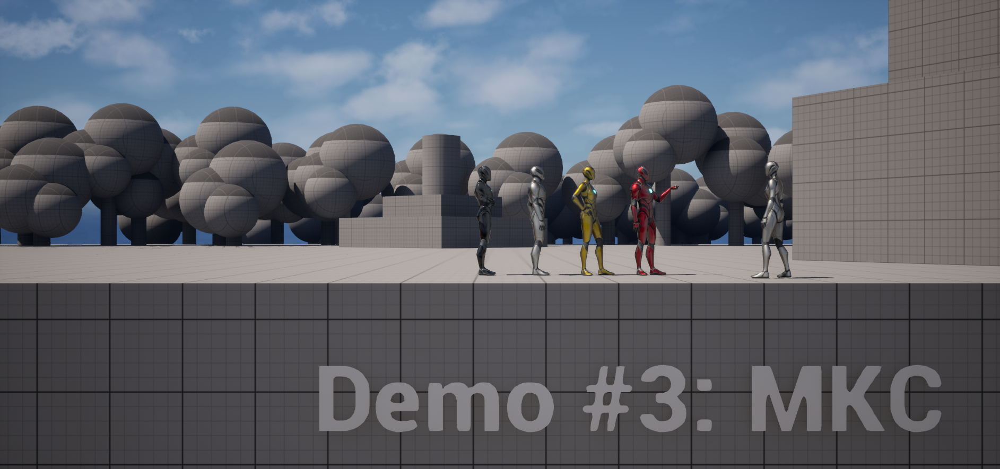

<h1>Big Mansion</h1>

 This project example shows you how the UDSH plugin works. This demo covers the MKC asset.

Keep in mind you have to manually enable the UDSH plugin in your project.

If you don't have the plugin, you can visit the fab store to add it to your UE environment for free: <a href="https://www.fab.com/sellers/Mohammed%20Kenawy" target="_blank">https://www.fab.com/sellers/Mohammed Kenawy</a>
